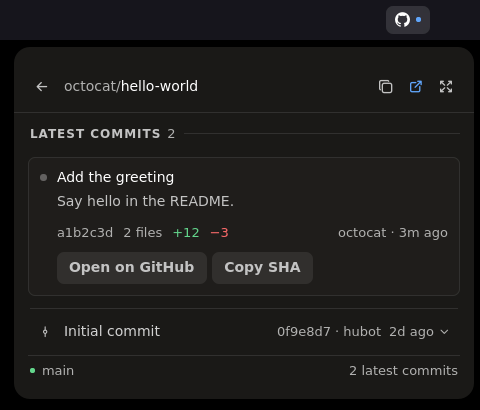

# GitHub for Cybex OS

A GitHub Inbox in your menubar. The widget shows the GitHub mark, a small dot
while workflows run, and a badge when Inbox items wait for you. Click it for:

- **Inbox**: running workflows, failed and action-required runs, notifications
  addressed to you, and pushes, pull requests, issues, releases and discussions
  in your recent and watched repositories. Settle an item to file it away
  (locally; nothing is marked read on GitHub).
- **Repositories**: your most recently pushed repositories plus the ones you
  watch, with search. Open one to see its latest commits and their diff sizes.
- **Account and watched repositories** (the gear): who you are signed in as,
  and the list of extra repositories to follow.



It is read-only. Everything goes through the GitHub CLI you are already signed
in to; the plugin never stores a token.

This was Cybex OS's built-in GitHub widget until Cybex OS moved it into this
plugin. Plugin id: `digitalpals.github-inbox`.

## Requirements

- Cybex OS with Omarchy plugin support (Settings → Plugins).
- [`gh`](https://cli.github.com/) on the desktop's PATH, signed in with
  `gh auth login`. Without it the popover says what is missing.
- Optional: `xdg-open` (open links), `wl-copy` (copy a URL or SHA),
  `notify-send` for toasts outside Cybex OS (Cybex OS supplies its own sender).

## Install

```bash
cybex plugin add https://github.com/DigitalPals/cybexos-github
```

Then enable **GitHub** in **Settings → Plugins** (or
`cybex plugin enable digitalpals.github-inbox --section right`).

The bar gives each plugin a fixed width, 120 pixels by default. That fits the
mark, the live dot and a "12 pending" count. With the badge on Dot or Off you
can narrow it: `cybex plugin enable digitalpals.github-inbox --width 48`.

## Settings

In **Settings → Bar & Control Center → GitHub**:

| Setting | Default | What it does |
| --- | --- | --- |
| Badge | Dot | Pending Inbox items as a coloured dot on the mark, a count, or nothing. Red means failures, amber other attention, accent general updates. The live-workflow dot shows either way. |
| Recent account repos | 8 (3–15) | How many of your most recently pushed account and org repositories the Inbox follows. |
| Repo refresh | 5 min (1–30) | How often the repository list, and quiet repositories' workflow runs, are read. Busy repositories are read every minute. |
| CI reports | On | Workflow rows in the Inbox. |
| Toasts | On | Notifications for pushes to watched repositories and for failed or action-required workflows. |

Watched repositories are edited in the popover (gear → Watched repos): type
`owner/repo` or paste a GitHub URL or SSH remote. Up to 20. They are saved as
the `watch` setting, which the settings dialog's raw JSON editor also shows.

Shortcuts: Escape steps back (commits → repositories, gear page → Inbox) and
then closes; Tab moves between controls; Enter or Space activates. Middle-click
the widget to refresh. Its IPC target, `digitalpals.github-inbox`, takes
`toggle`, `open`, `close` and `refresh`.

## How often it talks to GitHub

All reads are `gh api` calls, one at a time, with a 60-second limit (30 for a
commit you opened). The Inbox sweeps every minute; it uses ETags and
`If-Modified-Since`, so unchanged sources cost a `304`. It honours GitHub's
poll interval and stands down when the API quota runs low. Running workflows
are re-read every 30 seconds, for at most five repositories. Nothing is polled
while the session has been idle for five minutes, or while the plugin is off.

## Privacy and security

- The plugin runs `gh` as you; `gh` keeps the credential. The plugin never
  reads or stores a token, and keeps nothing in `plugins.json` but its options.
- Local state lives in `~/.local/state/cybexos/shell/github.json` (the same
  file the built-in used): read/seen times, the compact Inbox snapshot (titles,
  numbers, URLs), workflow baselines and HTTP validators. No API payload beyond
  what the Inbox shows is written. Delete the file to start fresh.
- Links open only as `http(s)` URLs through `xdg-open`.
- Plugins are trusted code running as you; Cybex OS does not sandbox them.

## Moving from the built-in widget

- Your Inbox state carries over: the plugin uses the built-in's state file.
- The first time it runs, the plugin reads the built-in's options from
  `~/.config/cybexos/shell.json` (`modOpts.gh`, read-only) and copies the ones
  you had changed, including the watch list, into its own settings. It does
  this once, and only while its own settings are still at their defaults.

### Differences from the built-in

- It sits in the bar's plugin area of its section, not between built-in
  widgets, and has a fixed slot width (see Install) rather than sizing itself.
- The badge follows its setting: **Dot** marks the GitHub mark, **Count** shows
  "N pending" (99+ at most), **Off** shows neither. The last built-in drew the
  "N pending" label for Dot and Off and nothing for Count.
- The popover is a Cybex OS plugin panel: the same layout, colours and type,
  drawn on the plugin card. It no longer shares the native popovers' opening
  animation or keyboard switching between neighbouring bar popovers.
- Polling pauses when you are idle, as before, but no longer when
  NetworkManager reports you offline (plugins cannot see that). Offline sweeps
  fail once and back off.
- Toasts go through `omarchy-notification-send` (or `notify-send`) instead of
  the shell's own notification call. They look like other app notifications.
- The account section and watch list moved from the Settings page into the
  popover's gear page. The other options are ordinary plugin settings.
- Text is English or Dutch, following the session language, as before.
- Focus rings follow keyboard use by a simpler rule than the shell's.

## Development

```bash
tests/run                      # unit tests: Node 18+, no Cybex OS needed
```

The real-engine check loads the plugin in Cybex OS's own Quickshell host,
headless (two outputs, isolated home, a fake `gh`), from a Cybex OS checkout:

```bash
cd /path/to/CybexOS
nix develop --command python3 /path/to/cybexos-github/tests/engine/run.py --cybexos . --shots /tmp/shots
```

`docs/manual-verification.md` lists the checks that need a real desktop and a
real GitHub account. `scripts/update-glyphs.cjs` regenerates the icon table
from Cybex OS's when icons are added.

## License

MIT, see [LICENSE](LICENSE). The Tabler icon font subset in `assets/tabler/` is
MIT (Tabler 3.48.0, its own LICENSE). The GitHub mark is from Simple Icons (CC0);
GitHub is a trademark of GitHub, Inc.
